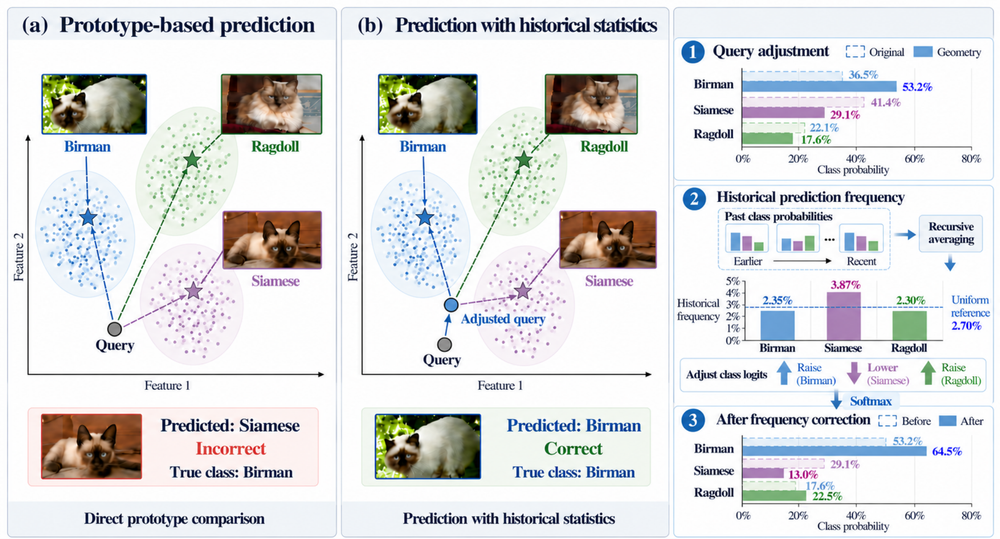
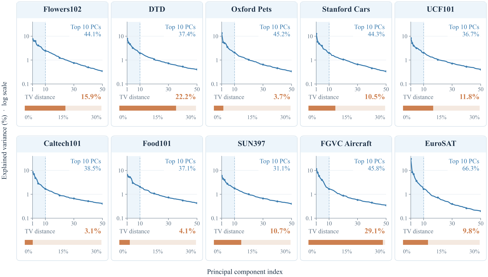
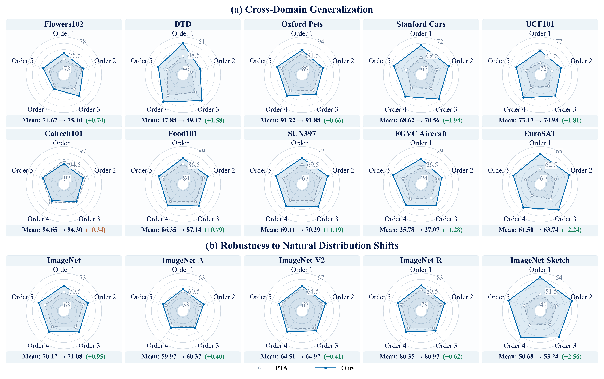
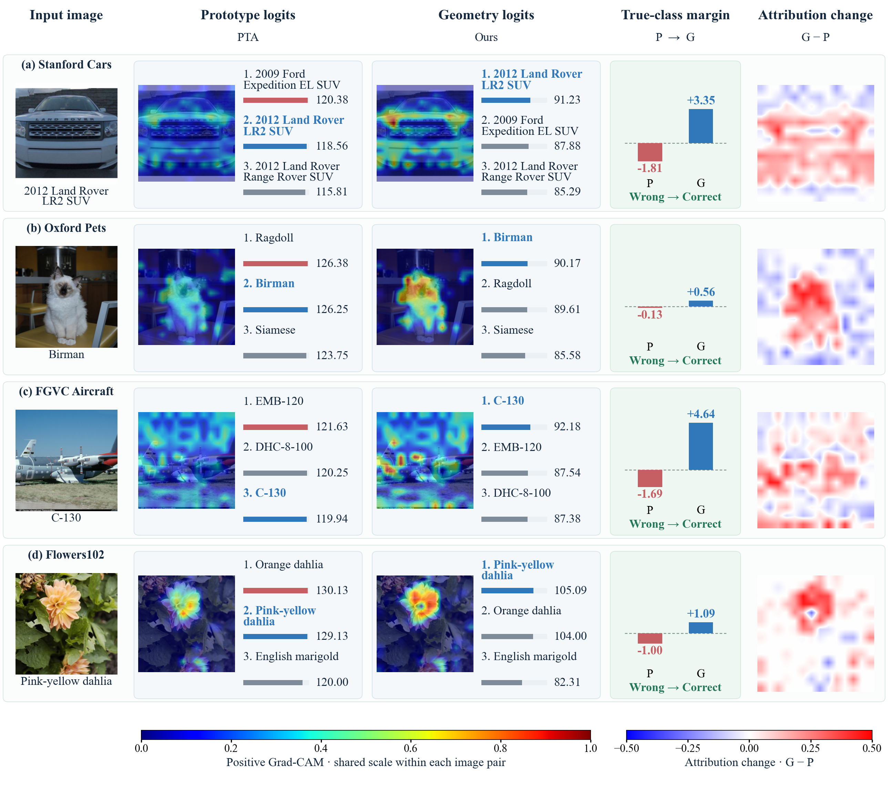

# FGM

**Frequency-Corrected Geometric Matching for Test-Time Adaptation of Vision-Language Models**

[Overview](#overview) · [Main results](#main-results) · [Test order analysis](#test-order-analysis) · [Visualization](#visualization) · [Installation](#installation) · [Data preparation](docs/DATA_PREPARATION.md)

FGM adapts predictions from frozen vision-language models using a shared prototype memory. Historical feature statistics adjust the geometry of prototype matching, and historical soft prediction frequencies correct relative class scores. The method requires no backpropagation and stores no image examples in its adaptation state.

## Overview



**Figure 1.** Geometric matching adjusts the query comparison, and frequency correction adjusts relative class scores. The feature-space arrangement illustrates the mechanism.



**Figure 2.** Feature variance spectra and total variation distances between predicted and observed class proportions across ten datasets. Shading marks the first ten principal components. These are retrospective diagnostics. The covariance and prediction-frequency estimates used for each prediction are computed from preceding observations. Adaptation does not access test labels.

## Main results

FGM achieves mean accuracy of **70.34%** with CLIP ViT-B/16 and **63.46%** with CLIP ResNet-50 across the ten datasets. The tables retain the manuscript numbering. Method names link to their papers. **Bold** and <ins>underlined</ins> values mark the best and second-best results among adaptation methods without backpropagation.

### Table 2. Ten-dataset accuracy (%) with CLIP ViT-B/16

| Method | Flowers102 | DTD | Oxford Pets | Stanford Cars | UCF101 | Caltech101 | Food101 | SUN397 | FGVC Aircraft | EuroSAT | Mean |
| :--- | ---: | ---: | ---: | ---: | ---: | ---: | ---: | ---: | ---: | ---: | ---: |
| [CLIP](https://proceedings.mlr.press/v139/radford21a.html) | 70.77 | 44.15 | 89.07 | 66.16 | 67.59 | 93.91 | 85.88 | 66.29 | 24.90 | 48.26 | 65.70 |
| **Adaptation with backpropagation** |  |  |  |  |  |  |  |  |  |  |  |
| [TPT](https://proceedings.neurips.cc/paper_files/paper/2022/hash/5bf2b802e24106064dc547ae9283bb0c-Abstract-Conference.html) | 68.98 | 47.75 | 87.79 | 68.50 | 68.04 | 94.16 | 84.67 | 65.50 | 24.78 | 42.44 | 65.26 |
| [DiffTPT](https://openaccess.thecvf.com/content/ICCV2023/html/Feng_Diverse_Data_Augmentation_with_Diffusions_for_Effective_Test-time_Prompt_Tuning_ICCV_2023_paper.html) | 70.10 | 47.00 | 88.22 | 67.01 | 62.67 | 92.49 | 87.23 | 65.74 | 25.60 | 43.13 | 64.92 |
| [DPE](https://proceedings.neurips.cc/paper_files/paper/2024/hash/38b787fc530d0b31825827e2cc306656-Abstract-Conference.html) | 75.07 | 54.20 | 91.14 | 67.31 | 70.44 | 94.81 | 86.17 | 70.07 | 28.95 | 55.79 | 69.40 |
| [HisTPT](https://proceedings.neurips.cc/paper_files/paper/2024/hash/178ae4ba29022eb7bf509c2e27bc8ab8-Abstract-Conference.html) | 71.20 | 48.90 | 89.10 | 69.20 | 70.10 | 94.50 | 89.30 | 67.20 | 26.90 | 49.70 | 67.61 |
| [GS-Bias](https://proceedings.mlr.press/v267/huang25aw.html) | 71.94 | 46.10 | 90.38 | 67.33 | 67.59 | 94.60 | 86.09 | 67.40 | 26.49 | 52.42 | 67.03 |
| **Adaptation without backpropagation** |  |  |  |  |  |  |  |  |  |  |  |
| [BoostAdapter](https://proceedings.neurips.cc/paper_files/paper/2024/hash/7d60bfd8458b67acbbaf18b892338d00-Abstract-Conference.html) | 71.66 | 45.69 | 89.51 | <ins>69.30</ins> | 71.93 | **94.77** | **87.17** | 68.09 | <ins>27.45</ins> | 61.22 | 68.68 |
| [MTA](https://openaccess.thecvf.com/content/CVPR2024/html/Zanella_On_the_Test-Time_Zero-Shot_Generalization_of_Vision-Language_Models_Do_We_CVPR_2024_paper.html) | 71.34 | 44.68 | 89.37 | 66.43 | 67.33 | <ins>94.32</ins> | 86.25 | 66.82 | 25.23 | 47.75 | 65.95 |
| [TDA](https://openaccess.thecvf.com/content/CVPR2024/html/Karmanov_Efficient_Test-Time_Adaptation_of_Vision-Language_Models_CVPR_2024_paper.html) | 71.50 | 45.09 | 89.37 | 67.03 | 70.82 | 94.08 | 86.27 | 67.81 | 25.32 | 62.51 | 67.98 |
| [BCA](https://openaccess.thecvf.com/content/CVPR2025/html/Zhou_Bayesian_Test-Time_Adaptation_for_Vision-Language_Models_CVPR_2025_paper.html) | 70.77 | 44.62 | 89.02 | 66.80 | 67.12 | 93.91 | 86.04 | 66.57 | 24.87 | 49.23 | 65.90 |
| [TCA](https://openaccess.thecvf.com/content/ICCV2025/html/Wang_Is_Less_More_Exploring_Token_Condensation_as_Training-free_Test-time_Adaptation_ICCV_2025_paper.html) | 73.33 | 46.16 | 89.53 | 65.33 | 72.38 | 93.69 | 85.31 | 65.92 | 24.87 | **70.43** | 68.70 |
| [SCA](https://proceedings.nips.cc/paper_files/paper/2025/hash/09eadc995e2a0293f1bc622a3e68fb18-Abstract-Conference.html) | <ins>74.45</ins> | 47.72 | 89.91 | 67.57 | 71.34 | 93.91 | 86.16 | 68.84 | 25.03 | 52.75 | 67.77 |
| [ADAPT](https://openreview.net/pdf/66f67be0809d947c24e38cf89235a80f90f3468d.pdf) | 73.28 | 46.57 | 91.58 | 68.56 | 70.58 | 93.39 | 85.72 | 69.09 | 25.59 | 63.06 | 68.74 |
| [OGA](https://openaccess.thecvf.com/content/CVPR2025W/MULA2025/html/Fuchs_Online_Gaussian_Test-Time_Adaptation_of_Vision-Language_Models._CVPRW_2025_paper.html) | 72.72 | 45.98 | <ins>91.69</ins> | 67.91 | 71.05 | 93.43 | 86.09 | 68.09 | 24.78 | <ins>64.19</ins> | 68.59 |
| [PTA](https://proceedings.mlr.press/v306/huang26cc.html) | 74.22 | <ins>48.05</ins> | 90.95 | 68.60 | <ins>73.30</ins> | 94.24 | 86.33 | <ins>69.21</ins> | 25.80 | 60.81 | <ins>69.15</ins> |
| **Ours** | **74.62** | **49.29** | **91.80** | **70.45** | **75.13** | 94.12 | <ins>87.10</ins> | **70.37** | **27.51** | 63.04 | **70.34** |

### Table 3. Ten-dataset accuracy (%) with CLIP ResNet-50

| Method | Flowers102 | DTD | Oxford Pets | Stanford Cars | UCF101 | Caltech101 | Food101 | SUN397 | FGVC Aircraft | EuroSAT | Mean |
| :--- | ---: | ---: | ---: | ---: | ---: | ---: | ---: | ---: | ---: | ---: | ---: |
| [CLIP](https://proceedings.mlr.press/v139/radford21a.html) | 66.06 | 42.97 | 85.75 | 56.31 | 61.96 | 87.79 | 77.37 | 61.16 | 16.89 | 36.16 | 59.24 |
| **Adaptation with backpropagation** |  |  |  |  |  |  |  |  |  |  |  |
| [TPT](https://proceedings.neurips.cc/paper_files/paper/2022/hash/5bf2b802e24106064dc547ae9283bb0c-Abstract-Conference.html) | 62.69 | 40.84 | 84.49 | 58.46 | 60.82 | 87.02 | 74.88 | 61.46 | 17.58 | 28.33 | 57.66 |
| [DiffTPT](https://openaccess.thecvf.com/content/ICCV2023/html/Feng_Diverse_Data_Augmentation_with_Diffusions_for_Effective_Test-time_Prompt_Tuning_ICCV_2023_paper.html) | 63.53 | 40.72 | 83.40 | 60.71 | 62.67 | 86.89 | 79.21 | 62.72 | 17.60 | 41.04 | 59.85 |
| [DPE](https://proceedings.neurips.cc/paper_files/paper/2024/hash/38b787fc530d0b31825827e2cc306656-Abstract-Conference.html) | 67.60 | 50.18 | 85.97 | 59.26 | 61.98 | 90.83 | 77.83 | 64.23 | 19.80 | 41.67 | 61.94 |
| **Adaptation without backpropagation** |  |  |  |  |  |  |  |  |  |  |  |
| [TDA](https://openaccess.thecvf.com/content/CVPR2024/html/Karmanov_Efficient_Test-Time_Adaptation_of_Vision-Language_Models_CVPR_2024_paper.html) | <ins>68.70</ins> | 43.62 | 86.15 | 57.39 | 63.81 | **89.70** | <ins>77.74</ins> | 62.37 | **17.40** | 41.23 | 60.81 |
| [BCA](https://openaccess.thecvf.com/content/CVPR2025/html/Zhou_Bayesian_Test-Time_Adaptation_for_Vision-Language_Models_CVPR_2025_paper.html) | 66.26 | 42.38 | 85.45 | 58.13 | 61.80 | 87.75 | 77.39 | 61.36 | <ins>17.28</ins> | 29.04 | 58.68 |
| [SCA](https://proceedings.nips.cc/paper_files/paper/2025/hash/09eadc995e2a0293f1bc622a3e68fb18-Abstract-Conference.html) | 67.72 | **46.69** | 86.43 | 59.23 | 66.03 | 88.40 | 76.72 | 63.17 | 17.01 | 48.51 | <ins>61.99</ins> |
| [ADAPT](https://openreview.net/pdf/66f67be0809d947c24e38cf89235a80f90f3468d.pdf) | 67.97 | 45.57 | <ins>87.76</ins> | <ins>59.68</ins> | 63.49 | 88.24 | 76.35 | <ins>63.77</ins> | 17.22 | 47.44 | 61.75 |
| [PTA](https://proceedings.mlr.press/v306/huang26cc.html) | 67.97 | 44.74 | 86.40 | 59.06 | <ins>66.64</ins> | <ins>89.45</ins> | 76.85 | 63.21 | 16.41 | <ins>48.85</ins> | 61.96 |
| **Ours** | **69.02** | <ins>46.04</ins> | **87.87** | **61.15** | **67.96** | 87.87 | **78.40** | **64.58** | 17.22 | **54.49** | **63.46** |

## Test order analysis



**Figure 8.** Accuracy (%) across five test orders. Each panel corresponds to one dataset and each spoke to one order. Every panel uses a five-unit accuracy window, with its baseline shown by the radial labels. Footers report mean accuracy for PTA and Ours, followed by the difference calculated from unrounded means.

## Visualization



**Figure 10.** Four selected successful corrections, with class scores, true-class margins, and paired Grad-CAM maps. Here, **Ours** denotes the geometric matching stage (G), before frequency correction. P denotes the prototype baseline. The final column shows the signed difference between the paired normalized maps.

## Contents

This repository contains source code, configurations, documentation, and the figures shown above. Model checkpoints, benchmark datasets, class metadata, feature caches, and runtime outputs are not included. External inputs and generated outputs are excluded by `.gitignore`.

```text
fgm/                    Method, configuration and augmentation
configs/                 Default and experiment-specific settings
scripts/prepare_manifest.py   Ordered image inputs and separate labels
scripts/extract_features.py   Single-view / multiview CLIP encoding
scripts/replay.py             Causal adaptation on cached features
scripts/score.py              Independent accuracy calculation
scripts/run_suite.py          Dataset suites and repeated stream orders
scripts/make_order.py         Controlled stream construction
scripts/compare_reference.py  Optional archived-code regression
tests/                   Synthetic regression and pipeline checks
third_party/             AugMix operators and license
docs/                    Input formats and reproduction details
assets/                  Figures displayed in this README
```

The image pipeline supports ViT-B/16 and ResNet-50. Point cloud experiments require externally prepared compatible embeddings.

## Installation

The evaluated environment used Python 3.10.15, PyTorch 2.1.1, torchvision 0.16.1, CUDA 11.8, NumPy 1.26.4 and an NVIDIA RTX 3090. CUDA is required for the historical FP16 numerical path. CPU float32 is supported for small functional checks, not exact numerical reproduction.

From this repository directory:

```bash
conda create -n fgm python=3.10.15 -y
conda activate fgm
python -m pip install torch==2.1.1 torchvision==0.16.1 --index-url https://download.pytorch.org/whl/cu118
python -m pip install -r requirements.txt
python -m pip install -r requirements-clip.txt
python -m pip install -e . --no-deps
python -m unittest discover -s tests -v
```

Git is required to install the pinned OpenAI CLIP dependency. The CUDA wheel includes its runtime, but a compatible NVIDIA driver is still required. See the [official PyTorch installation archive](https://pytorch.org/get-started/previous-versions/) and [OpenAI CLIP repository](https://github.com/openai/CLIP). Installing these dependencies does not download model checkpoints. Explicitly supply a local checkpoint below, or request a model download using `--model`.

## From raw images to accuracy

First prepare your benchmark test images, ordered class names, prompt templates and checkpoint externally. Use the prescribed benchmark splits. [Data preparation](docs/DATA_PREPARATION.md) describes both a generic ImageFolder manifest and an optional external benchmark-loader adapter.

For a generic dataset, `/external/classes.json` has this structure:

```json
{
  "class_names": ["cat", "dog"],
  "class_folders": ["cat_images", "dog_images"],
  "templates": ["a photo of a {}."]
}
```

The following is an executable workflow after substituting your own input paths:

```bash
python scripts/prepare_manifest.py --image-root /external/images --classes /external/classes.json --shuffle-seed 1 --output manifests/example
python scripts/extract_features.py --manifest manifests/example --checkpoint /external/weights/ViT-B-16.pt --protocol single --output cache/example
python scripts/replay.py --cache cache/example --config configs/default.json --output outputs/example/predictions.npz
python scripts/score.py --predictions outputs/example/predictions.npz --labels manifests/example/labels.npy --output outputs/example/accuracy.json
```

Run in the repository root. The same single-line commands work in PowerShell with quoted Windows paths. Images, metadata, checkpoints, caches and outputs stay outside version control. Manifest construction creates the evaluation labels. Feature extraction and adaptation do not open them. Only `score.py` reads labels after adaptation.

For **ImageNet-A, ImageNet-V2, ImageNet-R and ImageNet-Sketch**, replace `--protocol single` with `--protocol multiview`. The extractor creates 64 views per image, keeps the six lowest-entropy views, and saves their mean features and mean logits separately. `replay.py --cache ...` automatically uses `logits.npy` if present. The mean feature is not normalized again. A multiview forward pass has 64 views, while adaptation still advances once per image.

For **ResNet-50**, use its checkpoint, for example `--checkpoint /external/weights/RN50.pt`, and a separate cache directory. The method infers the feature dimension from the text bank.

## Existing cached features

The required array layout is:

| File | Shape | Type |
|---|---|---|
| `features.npy` | `[N, d]` | float16 |
| `text_weights.npy` | `[C, d]` | float16 |
| `logits.npy` | `[N, C]`, required for multiview | float16 |
| Evaluation labels, supplied to scoring only | `[N]` | integer |

Class indices must match the row order of `text_weights.npy`. The cache must represent one dataset and one encoder. A new model instance is created for each replay.

```bash
python scripts/replay.py --features /external/features.npy --text /external/text_weights.npy --logits /external/logits.npy --config configs/default.json --output outputs/predictions.npz
```

Omit `--logits` only for single-view inputs. Each replay saves predictions for `CLIP`, `Baseline`, `Geometry` and `Ours`, plus the stream permutation and a receipt. `Geometry` uses the geometric scores before frequency correction.

## Configurations

| Setting | Default |
|---|---|
| Prototype update `h` | 20, except Caltech101: 50 |
| Anchor coefficient `alpha` | 0.01 |
| Confidence threshold | 0.1 |
| Logit scale | 100 |
| Geometry weight | 0.5 |
| Frequency strength `gamma` | 2 |
| Frequency temperature | 2.25 |
| Frequency EMA rate | `1 / (10 * C)` |
| First transform / refresh interval | After 128 observations / every 128 |

```bash
python scripts/replay.py --cache cache/caltech101 --config configs/caltech101.json --output outputs/caltech101/predictions.npz
python scripts/replay.py --cache cache/example --config configs/frequency_only.json --output outputs/example/frequency_only.npz
python scripts/replay.py --cache cache/example --config configs/non_iid.json --order-file /external/order.npy --output outputs/example/non_iid.npz
```

`non_iid.json` sets `gamma=0`, matching the geometry-only setting used for class-concentrated streams. Add `--h 50` for Caltech101. In `frequency_only.json`, the `Ours` output applies frequency correction to the original baseline. These configuration names describe experiment conditions, not additional trained models.

## Dataset suites and test order

Prepare one cache and one label manifest per dataset key. `run_suite.py` uses the ten keys or five ImageNet keys listed in [data preparation](docs/DATA_PREPARATION.md), and automatically uses `h=50` for Caltech101. For a controlled uniform-h ablation, explicitly pass `--uniform-h VALUE` to override that exception. CPU suite checks require both `--device cpu --dtype float32`.

```bash
python scripts/run_suite.py --suite ten --cache-root cache/vit --labels-root manifests --output outputs/vit_ten
python scripts/run_suite.py --suite imagenet --cache-root cache/vit --labels-root manifests --output outputs/vit_imagenet
python scripts/run_suite.py --suite imagenet --cache-root cache/resnet50 --labels-root manifests --output outputs/resnet50_imagenet
python scripts/run_suite.py --suite ten --cache-root cache/vit --labels-root manifests --order-seeds 11 12 13 14 15 --output outputs/vit_order
```

Omitting `--order-seeds` preserves the cached order. For repeated runs, each method branch sees the same permutation and starts with a fresh state. Summary statistics use full-precision accuracies. Dataset means are calculated within each run before computing their sample standard deviations. OOD means exclude ImageNet. A newly generated input order is not guaranteed to equal the historical order unless the source enumeration and split are also identical.

`make_order.py` can prepare random, Dirichlet-block or class-separated streams. See [reproduction details](docs/REPRODUCTION.md). No benchmark data are included in this repository.

## Numerical release note

The default release guards zero or nonfinite prototype normalization by retaining the previous anchor. The valid arithmetic path is preserved. `--normalization legacy` reproduces the archived unguarded division and is available for regression. Warm-up retains the archived mixed-precision expression. See [validation scope](docs/VALIDATION.md) for the checks performed on this release.

## Acknowledgments

We acknowledge the authors of CLIP, PTA, and AugMix. See [THIRD_PARTY_NOTICES.md](THIRD_PARTY_NOTICES.md) for implementation credits and the licenses of third-party components.
